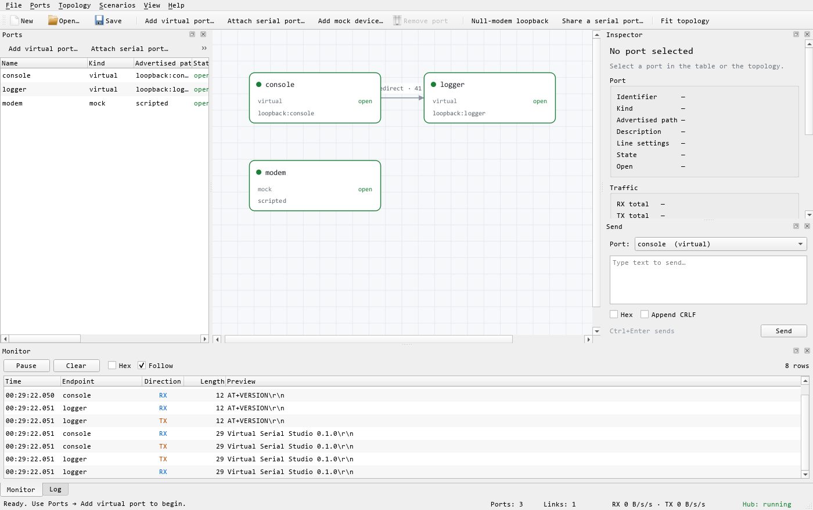

# Virtual Serial Studio

**A playground for real, virtual and networked serial ports.**

Virtual Serial Studio opens one serial port and gives it to as many applications
as you like. It splits a device across several virtual ports, merges several
publishers into one, redirects traffic, bridges a COM port to TCP, RFC 2217 or
UDP, drives the modem control lines, and records everything it sees. It is
built on [Boost.Asio](https://boost.org/libs/asio) and on
[Boost.VirtualSerial](https://github.com/iainchesworthlabs/virtual-serial), the drop-in serial stream
abstraction that makes the transport replaceable.



## What it can do

| Capability | How |
|---|---|
| Share one serial port with many applications | Create N virtual ports and `split` the real one across them |
| Merge several writers into one device | `join` two or more publishers into one target |
| Give an application its own serial port | Pseudo terminal on Linux/macOS, com0com pair on Windows, first-party driver planned |
| Replace com0com entirely | Seam in place; the Windows driver is specified in [docs/windows-com-driver.md](docs/windows-com-driver.md) |
| Bridge a device to the network | `tcp://`, `udp://` and `rfc2217://` endpoints are first-class ports |
| Test RS-232 control lines | DTR/RTS/BREAK are drivable, CTS/DSR/DCD/RI are reported, a null-modem link crosses them |
| Watch traffic without disturbing it | One-way `monitor` links and a bounded traffic ring buffer |
| Script a device | The serial library's mock backend is exposed as an endpoint |
| Save and reload a topology | Validated JSON documents, opened by the GUI and by `vss_cli run` |
| Measure the data path | `vss_cli bench` and a CI performance suite with enforced floors |

## Documentation

- [docs/user-guide.md](docs/user-guide.md) — how to use the application: both modes, everyday jobs, network tools and troubleshooting.
- [docs/ux.md](docs/ux.md) — who the interface is for, the simple/advanced design, and the human-factors decisions.
- [docs/architecture.md](docs/architecture.md) — how the libraries, hub and transports fit together.
- [docs/scenarios.md](docs/scenarios.md) — worked recipes for share, join, bridge and loopback.
- [docs/profiling.md](docs/profiling.md) — Tracy zones and how to capture a trace.
- [docs/windows-com-driver.md](docs/windows-com-driver.md) — the optional KMDF COM port driver.
- [docs/vm-testing.md](docs/vm-testing.md) — the VMware guest matrix and driver tests.

## Building

Requirements: CMake 3.21+, a **C++23** compiler, Boost 1.74+ headers and git.
CI builds with the versions pinned in `.github/toolchain-versions.json`: GCC 16,
Clang 23, MSVC 19.51 and Qt 6.12.
CMake fetches [Boost.VirtualSerial](https://github.com/iainchesworthlabs/virtual-serial) at a release tag.
Qt 6 is optional and only needed for the GUI. CMake looks for it through
Qt's own config package first, then looks in `VSS_QT_ROOT`, `ICL_QT_ROOT`,
`QT_ROOT_DIR`, `QTDIR` and the usual install locations. The
`*-gui` presets make a missing Qt an error instead of silently building the
CLI alone.

```bash
# Boost headers, if you do not already have them
python tools/fetch_boost.py --dest .cache/boost-root

cmake -S . -B build \
  -DCMAKE_BUILD_TYPE=Release \
  -DVSS_BOOST_ROOT="$PWD/.cache/boost-root" \
  -DCMAKE_PREFIX_PATH=/path/to/Qt/6.12.0/msvc2022_64   # optional; Qt is auto-detected

cmake --build build
ctest --test-dir build --output-on-failure
```

On Windows, run the configure and build from a Visual Studio developer prompt
(`vcvars64.bat`) so CMake can find `cl.exe`. To build against a local checkout
of the library, set `VSS_VIRTUAL_SERIAL_DIR` to it, for example in a
`CMakeUserPresets.json` (Git ignores that file). `VSS_FETCH_VIRTUAL_SERIAL`,
`VSS_VIRTUAL_SERIAL_GIT_REPO` and `VSS_VIRTUAL_SERIAL_GIT_TAG` control the
fetched release.

Options: `VSS_BUILD_TESTS`, `VSS_BUILD_GUI`, `VSS_GUI_REQUIRED`,
`VSS_BUILD_TOOLS`, `VSS_BUILD_PERF`, `VSS_TRACY`, `VSS_COVERAGE`,
`VSS_INSTALL`.

`CMakePresets.json` provides:

| Preset | What it builds |
|---|---|
| `linux-debug`, `linux-release`, `macos-debug`, `macos-release`, `windows-msvc-debug`, `windows-msvc-release` | Tests and tools, no GUI. The release presets also build the performance suite |
| the same names with `-gui` | The same plus the GUI; **fails** if Qt is missing |
| `linux-coverage`, `macos-coverage`, `windows-llvm-coverage` | Instrumented libraries (Clang, LLVM profiles), no GUI |
| `linux-asan-ubsan`, `linux-tsan` | Clang with AddressSanitizer and UBSan, or ThreadSanitizer, at -O1 (`ICL_SANITIZERS`); no GUI |
| `linux-tracy`, `windows-msvc-tracy` | Performance suite with Tracy, no GUI; needs `VCPKG_ROOT` |

A preset only exists on the operating system it names. Each builds in `build/<preset>`. The compiler is the one in `CC` and `CXX`, or the platform default.

Set `VSS_QT_ROOT` (or `-DCMAKE_PREFIX_PATH=...`) only when the automatic search
picks the wrong kit; otherwise no environment variable is needed. `ICL_QT_ROOT`
is the per-machine setting shared with the other projects of the organisation:

```bash
# Linux example
export VSS_QT_ROOT=$HOME/Qt/6.12.0/gcc_64
cmake --preset linux-release-gui
cmake --build --preset linux-release-gui
ctest --preset linux-release-gui

# Windows (from a vcvars64 prompt)
set VSS_QT_ROOT=C:\Qt\6.12.0\msvc2022_64
cmake --preset windows-msvc-release-gui
cmake --build --preset windows-msvc-release-gui
```

`VSS_QT_ROOT` is the directory that contains `lib/cmake/Qt6`. If it is unset and
Qt is not on `CMAKE_PREFIX_PATH`, the `*-gui` presets stop with an explanatory
error; `-DVSS_GUI_REQUIRED=OFF` restores the old "build the CLI only"
behaviour.

`VSS_TRACY` is on by default in Debug builds configured through the vcpkg
toolchain and off in Release. Pass `-DVSS_TRACY=ON` to a Release build when a
release binary needs to be profiled; the client idles until a profiler
attaches.

### Language standard

The application targets **C++23** (`std::span`, `std::string_view`, defaulted
comparisons, designated initialisers, concepts, `std::to_underlying`) and builds
clean with MSVC `/std:c++latest` and clang-cl `-std=c++23`, with warnings as
errors.

C23 is the *C* standard and does not apply to a C++/Boost.Asio application; if
you meant "the newest standard", C++23 is that target. Boost.VirtualSerial
itself keeps a C++14 baseline with C++20 concepts, so consuming it from a
C++23 translation unit is strictly compatible — the library is never asked to
compile as anything newer than it already supports.

Two deliberate deviations from what a greenfield C++23 codebase might do:

* `vss::result<T>` is `boost::system::result`, not `std::expected`. The serial
  library, Boost.Asio and the OS all speak `boost::system::error_code`; using
  `std::expected` would put a conversion at every boundary and lose the
  `error_code` category messages. `boost::system::result` is the idiomatic
  choice inside the Boost ecosystem and already offers `and_then`/`transform`.
* The event sink is type-erased behind `std::function` at the API boundary
  (constrained by the `vss::EventSink` concept) rather than templated through
  the hub. One indirection per event buys a stable, non-template `hub` type and
  a dispatcher that does not have to be recompiled for every callable.

## Quick start

### The GUI

```bash
vss_gui
```

`Ports -> Add virtual port` creates a port and tells you the path another
application should open. `Ports -> Attach serial port` opens a real device,
an RFC 2217 server or a TCP/UDP bridge. `Topology` links ports, `Scenarios`
builds the common shapes in one click, and the monitor shows the traffic as it
flows. `File -> Save` stores the topology as JSON.

The GUI can also prove itself without a display or a user:

```bash
QT_QPA_PLATFORM=offscreen vss_gui --selftest
```

### The command line

```bash
vss_cli devices                     # serial ports and com0com pairs
vss_cli virtual                     # one virtual port; prints what to open
vss_cli loopback                    # a virtual port plus a monitor, no hardware
vss_cli share serial://COM3 --listeners=3 --seconds=30
vss_cli bridge serial://COM3 tcp://192.168.1.50:4001 --seconds=30
vss_cli run lab.json --seconds=60
vss_cli bench --from=serial://COM3 --to=serial://COM5 --bytes=10MB
vss_cli selftest
```

Run `vss_cli --help` for the full list.

### A topology file

```json
{
  "version": 1,
  "name": "lab",
  "ports": [
    { "name": "device", "kind": "physical",
      "uri": "serial://COM3?baud=115200",
      "serial": { "baud_rate": 115200, "parity": "none" } },
    { "name": "terminal", "kind": "virtual", "virtual_kind": "auto" },
    { "name": "logger",   "kind": "virtual", "virtual_kind": "loopback" }
  ],
  "links": [
    { "mode": "split", "sources": ["device"], "targets": ["terminal", "logger"] }
  ]
}
```

`vss_cli run lab.json` applies it; the GUI opens the same file.

## The model

Three ideas carry the whole application.

**An endpoint** is one transport with a name: a real UART, a pseudo terminal, a
com0com end, a TCP socket, an RFC 2217 session, or a mock device. It owns its
read loop, write queue, counters and control-line state, and it is driven on a
strand so a transport is never touched by two threads at once.

**A link** connects endpoints. `duplex` links carry traffic both ways, `one_way`
links carry it one way, and `monitor` links are passive taps that do not drive
the peer's modem lines. A single link can fan out to many targets (`split`) or
accept many sources (`join`), and every link can arbitrate between publishers:
either `interleave` them or give one publisher `owner`ship.

**A hub** owns the `io_context`, the endpoints, the routing table and the event
dispatcher. The `studio` layer above it adds the bits applications need:
advertised paths, composite scenarios, JSON persistence and com0com detection.

```
vss_cli / vss_gui
      │
   vss_studio      studio: scenarios, persistence, advertised paths
      │
  ┌───┴──────────────┬─────────────────┐
vss_config       vss_ports          vss_core
 JSON documents   PTY, com0com,     hub, endpoint, links,
                  native lines,     control lines, events
                  serial transport
```

## Virtual ports by platform

| Platform | Kind | What a third-party application opens |
|---|---|---|
| Linux, macOS | `pty` | `/dev/pts/N` — a real terminal that behaves like a serial port |
| Windows | `auto` with com0com installed | One end of a com0com null-modem pair, e.g. `COM5` |
| Any | `loopback` | An in-process device: useful for demos, monitoring and tests |

`auto` picks the best available kind and reports the path it chose. A pair is
never wired into the hub twice: once an endpoint claims a com0com pair, later
listeners fall back to loopback instead of fighting over the same device.

On Windows, creating a **new** com0com pair needs administrator rights, because
`setupc.exe` carries an elevation manifest. `vss::detect_com0com()` and the pair
list work without elevation, and the GUI reports the installation state.

## Control lines

Every endpoint models DTR, RTS, CTS, DSR, DCD, RI and BREAK. The front end
drives DTR, RTS and BREAK, and reports the rest. When two endpoints are linked
with `emulate_modem_lines` (the default), the link behaves like a null-modem
cable:

```
A.DTR ──► B.DSR        A.RTS ──► B.CTS
B.DTR ──► A.DSR        B.RTS ──► A.CTS
```

That is enough to exercise software that watches carrier detect, requires
hardware flow control, or treats a dropped DTR as a hang-up. The inspector in
the GUI drives the lines directly; `endpoint::set_line` does the same from code.
On a device that cannot support a line the call reports `errc::unsupported`
rather than pretending to work.

## Testing

The repository ships unit, system and performance suites, all driven by CTest.

```bash
ctest --test-dir build --output-on-failure
./build/bin/vss_unit_tests --filter=hub --verbose
./build/bin/vss_unit_tests --list
```

* **Unit** (149 cases) — bytes, control lines, serial settings, errors,
  traffic log, the loopback transport, endpoints, topology, events, serial
  transport, virtual ports, enumeration, com0com parsing, JSON documents and
  the studio facade.
* **System** (12 cases) — a real serial pair (a com0com pair on Windows, or
  `VSS_LOOPBACK_A`/`VSS_LOOPBACK_B` elsewhere) carries data both ways, survives
  a 256 KB integrity transfer, shares a port with listeners, drives the native
  control-line layer, rolls back a failed bridge, and live TCP **and UDP**
  peers exercise the network bridges. Every case skips cleanly when no hardware
  exists, unless `VSS_REQUIRE_LOOPBACK=1` is set — which CI does, so a missing
  pair fails the job instead of quietly reducing what is tested. Linux and
  macOS CI create the pair with `tools/pty_loopback.py`, so the physical
  backend runs on every platform.
* **Performance** — routing, event dispatch, JSON round-trips and mock writes,
  gated against `perf/floors.json`.
* **Profiling** — `VSS_TRACY=ON` instruments the pipeline with Tracy from
  vcpkg; CI captures a trace of a real socket and pseudo-terminal round trip,
  exports it with `tracy-csvexport` and publishes the per-zone table. See
  [docs/profiling.md](docs/profiling.md).

### Coverage

Coverage uses LLVM profile instrumentation and is gated at **90% statements**
and **80% branches**:

```bash
export CXX=clang++
cmake --preset linux-coverage
cmake --build --preset linux-coverage
mkdir -p build/linux-coverage/profiles
LLVM_PROFILE_FILE="$PWD/build/linux-coverage/profiles/%p-%m.profraw" \
  ./build/linux-coverage/bin/vss_unit_tests
LLVM_PROFILE_FILE="$PWD/build/linux-coverage/profiles/%p-%m.profraw" \
  ./build/linux-coverage/bin/vss_system_tests
python tools/coverage_report.py --build build/linux-coverage \
  --exclude libs/vss_testkit \
  --gate-exclude libs/vss_ports/src/vcom_driver.cpp \
  --min-lines 90 --min-branches 80
```

Measured on Windows 11, clang-cl 23, Debug: **90.15% statements**, **82.28%
branches**. The report lists every file and marks the ones outside the gated
set; `vcom_driver.cpp` is outside it until the driver exists, because its
detection path needs an installed kernel driver to exercise.

### Performance

```bash
vss_perf --output=perf-results.json
python tools/perf_report.py perf-results.json --floors perf/floors.json
```

Indicative results (Windows 11, MSVC 19.51, x64, Release, `vss_perf`):

| Benchmark | Result |
|---|---|
| `hub_route` | ~2.4 GB/s |
| `event_dispatch` | ~1,230,000 events/s |
| `config_roundtrip` | ~2,850 documents/s (23 KB each) |
| `mock_write` | ~359 MB/s |

### Profiling

Tracy is compiled into Debug builds by default, and can be turned on in a
Release build when a field problem needs triage. It runs in on-demand mode, so
no data is recorded until a profiler connects — attaching to an already
running process is the normal workflow.

```bash
# Debug: Tracy is on when configured with the vcpkg toolchain
cmake --preset linux-debug \
  -DCMAKE_TOOLCHAIN_FILE="$VCPKG_ROOT/scripts/buildsystems/vcpkg.cmake"

# Release: opt in explicitly when something needs profiling
cmake -S . -B build-rel-tracy -DCMAKE_BUILD_TYPE=Release -DVSS_TRACY=ON \
  -DCMAKE_TOOLCHAIN_FILE="$VCPKG_ROOT/scripts/buildsystems/vcpkg.cmake"
cmake --build build-rel-tracy

# Attach at any point, then export
tracy-capture -o trace.tracy &
./build-rel-tracy/bin/vss_perf --tracy
wait
tracy-csvexport trace.tracy > trace.csv
python tools/tracy_report.py trace.csv
```

The report covers the hub, endpoint, JSON and transport paths plus a real
socket echo and a pseudo-terminal round trip. CI publishes it for every push;
see [docs/profiling.md](docs/profiling.md) for the zone list and caveats.

## Continuous integration

`.github/workflows/ci.yml` first runs the shared policy checks and a planner that
skips the builds for documentation-only changes, then builds with GCC, Clang, AppleClang and MSVC, runs
the GUI self-test on Linux with Qt, enforces the coverage gates, runs the
performance floors, captures a Tracy profile of the end-to-end path, and
validates every changelog fragment. Boost is fetched by
`tools/fetch_boost.py`, so no job depends on a system Boost. Development lands on `develop` (the trunk and default branch); `main` is the release branch and only receives merges from `develop` when a release is cut.

## Changelog

Every change lands as one fragment in [`changelog.d/`](changelog.d/README.md):

```bash
python tools/changelog.py --check
python tools/changelog.py --dry-run
python tools/changelog.py --release 0.2.0
```

## Repository layout

```
libs/vss_core        hub, endpoints, links, control lines, events
libs/vss_ports       serial transport, PTY, loopback, com0com, enumeration
libs/vss_config      JSON topology documents
libs/vss_studio      the application service shared by the CLI and the GUI
libs/vss_testkit     reusable fakes and helpers for tests
apps/vss_cli         headless command line
apps/vss_gui         Qt 6 desktop application
tests/               in-tree framework, unit and system suites
perf/                performance suite and floors
cmake/               dependency, warning, coverage and sanitizer helpers
tools/               Boost fetch, changelog, coverage and performance reports,
                     the PTY pair helper and the commit-message checker
docs/                user guide, design notes and scenario recipes
```

## Known limits

* A real Windows `COMx` still comes from com0com. Windows has no user-mode COM
  port API, so replacing com0com needs the kernel driver described in
  [docs/windows-com-driver.md](docs/windows-com-driver.md). The application
  already detects that driver, prefers it when present, and accepts
  `"virtual_kind": "windows-driver"` in saved topologies.
* A named-pipe virtual port is not implemented.
* Two loopback virtual ports cannot be linked duplex: a loopback device echoes
  its writes into its own receive path, which is a feedback loop. The GUI's
  null-modem demo therefore uses a one-way link, and real devices do not have
  the problem.
* Creating a com0com pair needs elevation; everything else runs unprivileged.
* Linking the two ends of a real null-modem cable through the hub is a physical
  loop, exactly as it would be with any serial forwarder. Attach one end and
  let the peer be the application.

## Roadmap

1. **Windows COM driver** — the one piece that cannot be user-mode. Phase 0
   (detection, selection order, configuration, ABI design) is done; the next
   milestone is a test-signed driver that creates a port and carries bytes,
   then the full serial contract (timeouts, purge, wait mask, line control),
   then signing and an installer.
2. **Named-pipe virtual ports** — a cross-process port for applications that
   accept a pipe path, useful on machines without a driver.
3. **macOS `/dev/cu.*` aliases** — an opt-in helper that creates a symlink with
   authorisation, for software that hardcodes the name.

## License

Virtual Serial Studio is free software: you can redistribute it and/or modify
it under the terms of the **GNU General Public License, version 3 or later**
(`GPL-3.0-or-later`). It is distributed in the hope that it will be useful, but
WITHOUT ANY WARRANTY; without even the implied warranty of MERCHANTABILITY or
FITNESS FOR A PARTICULAR PURPOSE. The full text is in [LICENSE](LICENSE).

Every first-party source file carries an SPDX licence line naming
GPL-3.0-or-later.

The dependencies keep their own terms, all compatible with the GPL:

* [Boost.VirtualSerial](https://github.com/iainchesworthlabs/virtual-serial) and Boost itself are
  **BSL-1.0**; BSL-1.0 is a permissive licence that can be combined with GPLv3.
* Qt 6 is **LGPL-3.0 / GPL-3.0 / commercial**; the GUI links it dynamically.
* `com0com` is an optional, separately installed Windows driver, invoked rather
  than linked.
* Three tools in `tools/` are derived from the Boost.VirtualSerial repository
  and remain **BSL-1.0**.

[THIRD_PARTY_NOTICES.md](THIRD_PARTY_NOTICES.md) records the details.

If you distribute binaries, section 6 of the GPL requires you to make the
Corresponding Source available to the people you distribute to.
