# Using Virtual Serial Studio

This guide is for people using the desktop application. It covers the two
levels of the window, the everyday jobs, the expert tools, and what to check
when something does not work.

The application is a window over the `vss::studio` engine: it creates ports,
wires them together, and shows what flows through them. Everything it can do
can also be scripted with `vss_cli`; the command equivalents are listed near
the end.

The pictures were taken from Virtual Serial Studio running on Windows 11 and
Ubuntu 26.04 test machines, in the light theme unless the text says
otherwise. Port names such as `COM7` and `/dev/pts/1` are examples; yours will
differ.

## Simple and Advanced

The window has a **Simple** level and an **Advanced** level. Simple is the
default and is built for one job: "I need a serial port, now." Advanced adds
the tools an integrator or a diagnostician needs, in the same window. Nothing
you have built changes when you switch.

| | Simple | Advanced |
|---|---|---|
| Launcher with four jobs | Yes | Yes |
| Add a virtual port, a linked pair or a real device | Yes | Yes |
| Connect ports, share a device, watch traffic | Yes | Yes |
| Network endpoint and mock fixture | Hidden | Shown |
| Ports table | Name, role, state, path | Adds RX, TX, Dropped and a filter |
| Inspector | State, path, traffic, control lines (read only) | DTR and RTS switches, Break |
| Send | Text or hex, Add CRLF | Adds Repeat and saved sends |
| Monitor | Pause, Clear, Hex, Follow | Adds filters, search, Export, Log and Topology JSON tabs |
| Link wiring, owner controls, Benchmark, Export as command, Fit | Hidden | Shown |
| Dialogs | Guided, with defaults | Editable addresses and More options |

Switch with **View → Advanced mode** (`Ctrl+Shift+A`), the switch at the right
of the status bar, **Settings**, or the link in the launcher. The choice is
remembered and applies to every document. Commands hidden in Simple still
appear in the command palette, with a prompt that they need Advanced mode.

## The window at a glance

```
┌──────────────────────────────────────────────────────────────────────┐
│ File  Edit  Ports  Topology  Tools  View  Help                       │
├──────────────────────────────────────────────────────────────────────┤
│ New Open Save │ Add port  Attach  Connect  Remove        [Search ⌘K] │
├───────────────┬──────────────────────────────────┬───────────────────┤
│ Ports         │  Topology                        │ Inspector         │
│ name  state   │   ┌────────┐      ┌────────┐     │ state, path       │
│ role  path    │   │ port A │──────│ port B │     │ traffic, lines    │
│               │   └────────┘      └────────┘     ├───────────────────┤
│               │                                  │ Send              │
├───────────────┴──────────────────────────────────┴───────────────────┤
│ Monitor                                                              │
├──────────────────────────────────────────────────────────────────────┤
│ Ports 2  Links 1  RX  TX  Hub running      Setup ready  [Simple|Adv] │
└──────────────────────────────────────────────────────────────────────┘
```

- **Ports** (left): one row per port with its name, a state chip, a line saying
  what it is for, and its path with a copy button. The path is what your other
  program opens. Select a port here, in the topology or in the monitor, and the
  other two follow.
- **Topology** (centre): one box per port and one line per link. Click a box to
  inspect it and a line to select the link. **View → Show links as a list**
  gives the same links as a list that a screen reader can walk.
- **Inspector** (right): details for the selected port and the control lines.
  A port that nothing has opened yet links to "Why is nothing arriving?".
- **Send** (right): write bytes into an open port.
- **Monitor** (bottom): traffic rows with time, port, direction, bytes and a
  preview. In Advanced it has two more tabs, **Log** and **Topology JSON**.
  When the JSON has an error, the editor names the line, marks it, and
  **Go to line** jumps to it. That covers syntax mistakes, bad names, kinds,
  modes and links, and invalid serial settings.
- **Status bar**: port and link counts, receive and transmit rates, hub state,
  a readiness chip that opens the setup check, and the Simple/Advanced switch.

To rename a port, select it and press `F2`, or use **Ports → Rename port** or
the node's context menu. Links and the saved setup use the new name. A
pseudo terminal on Linux or macOS moves its stable path to the new name, so
a program that opened it by that path needs the new one. The path of every
other kind stays as it was made.

The window opens at 1280 by 800 and works down to 960 by 640. Dock sizes are
remembered; **View → Reset layout** puts them back. **Theme** (follow the
system, light or dark) and **Density** (comfortable or compact) are under
**View** too.

The launcher in the dark theme:

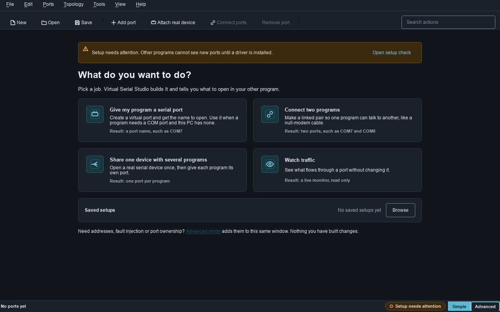

The launcher in the compact density at the smallest window size, 960 by 640:

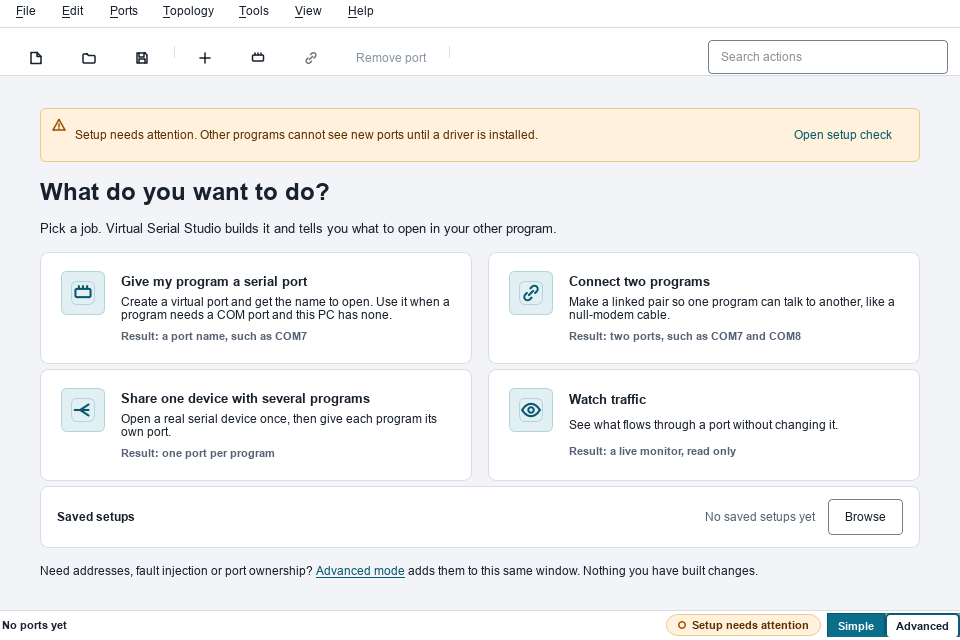

## The launcher

When the studio has no ports, the window shows a launcher instead of the docks.
It opens with a strip that says whether this PC is ready to create ports other
programs can open, then four jobs:

1. **Give my program a serial port.** Creates a virtual port and tells you the
   name to open.
2. **Connect two programs.** Creates a linked pair, like a null-modem cable.
3. **Share one device with several programs.** Opens the share wizard.
4. **Watch traffic.** Starts a read-only copy of a port's traffic.

Below the cards, **Saved setups** shows your most recent file with **Open** and
**Browse**. The launcher goes away when the first port exists. **View → Show
launcher** brings it back.

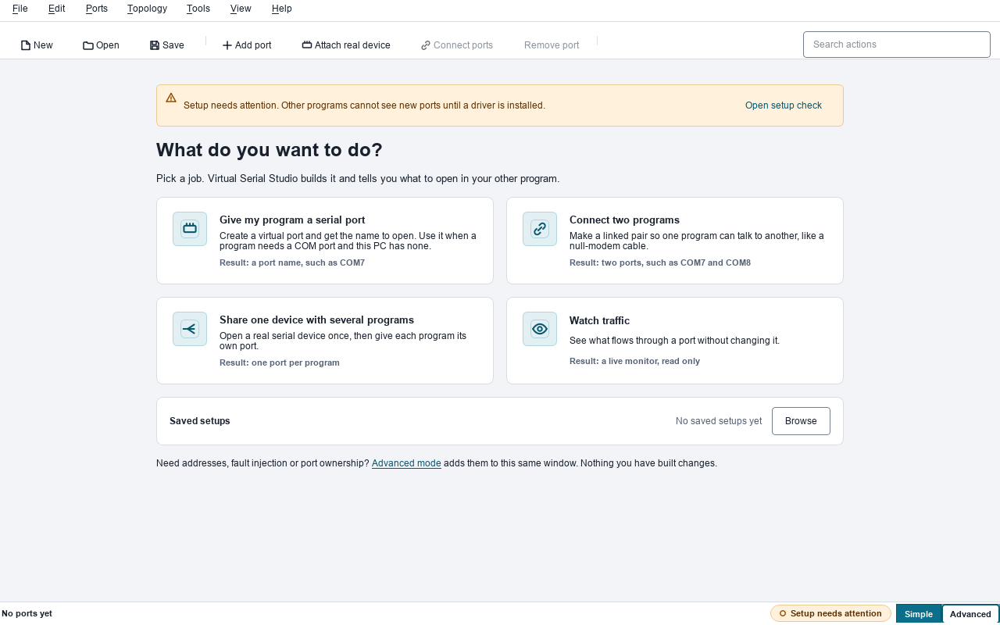

## Quick start

1. Choose **Give my program a serial port** (or **Ports → Add port**,
   `Ctrl+Shift+N`) and press **Create port**.
2. The **Port ready** dialog shows the name to open, for example `COM7` on
   Windows or `/dev/pts/3` on Linux. Press **Copy name**.
3. In the other program, choose that port. Whatever it writes appears in the
   monitor.
4. To try the port without another program, use the **Send** panel: pick the
   port, type text, press **Send**, and watch the monitor.

On Linux the **Port ready** dialog looks like this:

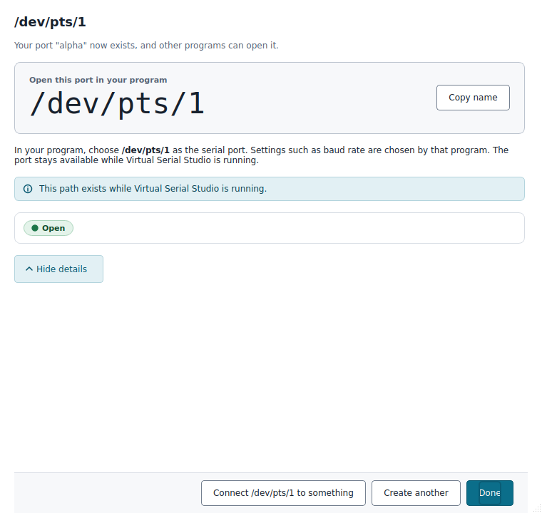

## Adding a port

**Ports → Add port** (`Ctrl+Shift+N`) asks what the new port should be:

- **Virtual port** — a port other programs can open.
- **Linked pair** — two ports wired together like a null-modem cable.
- **Real device** — a serial device plugged into this PC, so you can share it.
- In Advanced, **Network endpoint** (a TCP, UDP or RFC 2217 address used as a
  port) and **Mock fixture** (a scriptable pretend device for tests).

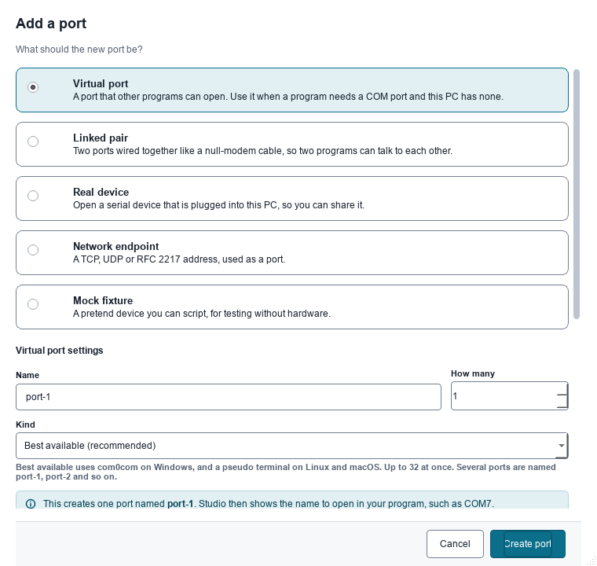

### Virtual port

- **Name**: a unique suffix is added if the name is taken. With **How many**
  above one, names run `port-1`, `port-2` and so on. The number must be 1 to
  32.
- **Kind**: *Best available (recommended)* uses com0com on Windows when it is
  installed and a pseudo terminal on Linux and macOS; *Pseudo terminal*; or
  *In-process loopback*, whose port only Studio can open. On Windows there are
  no pseudo terminals, so *Pseudo terminal* gives the same result as *Best
  available*.

A sentence under the form says what will be created. When you press **Create
port**, the **Port ready** dialog opens with the path in large type, **Copy
name**, a note on how to use it, and **Connect COM7 to something**, **Create
another** and **Done**. **Show details** gives the saved-setup entry and the
equivalent `vss_cli` command. Without a driver on Windows the title reads
"port-1 is ready inside Studio" and the dialog warns that other programs cannot
open it, with a button for the setup check.

### Linked pair

**Connect two programs** creates two ports that talk to each other. Choose the
pair name. The two port names are shown for you to read: on Windows they come
from the free com0com pairs, and on Linux and macOS they are paths such as
`/dev/pts/3`. DTR is wired to DSR and RTS to CTS, as on a standard null-modem
cable. The dialog uses a pair that already exists and never creates one, so it
does not ask for administrator permission. When there are not enough free
driver pairs, the button is disabled and the dialog points to the setup check;
the share wizard can create another pair. In Advanced, **More options** offers
the port kind.

The picture shows a Windows PC with no free com0com pairs: **Create pair** is
off and the dialog points to the setup check.

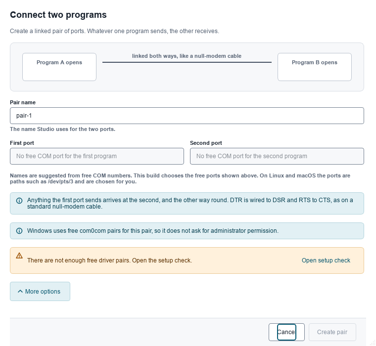

### Real device

**Attach a real device** lists the serial devices when the dialog opens; press
**Refresh** after plugging one in. A com0com pair end is listed as *Virtual* and
cannot be chosen, because it is a port and not a device. Studio cannot tell in
advance that another program holds a device: if it does, opening fails with a
message that offers **Try again** and **Choose another**. In the Add port
dialog, choosing *Real device* and pressing **Next** opens this dialog.

The settings (baud rate, data bits, parity, stop bits, flow control) are folded
away in Simple with a one-line summary and open in Advanced. **Use common
defaults** sets 115200 8N1. Keep **Capture traffic in the monitor** ticked to
record it. The dialog shows the address it will use, for example
`serial://COM3?baud=115200`; in Advanced you can edit it and the edit wins over
the fields.

Studio opens the device once and keeps it open. Your programs open the port
that Studio creates, not the device.

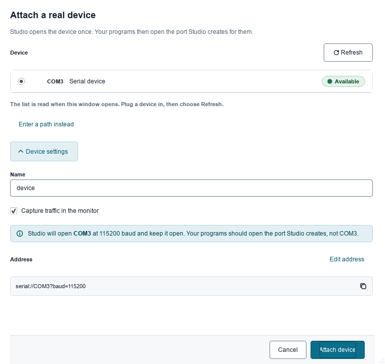

### Network endpoint (Advanced)

A TCP, UDP or RFC 2217 address used as a port. Choose the transport, then
whether Studio **connects to a server** or **waits for other computers to
connect (server)**. Waiting works for TCP, UDP and RFC 2217. See
[network addresses](#network-addresses).

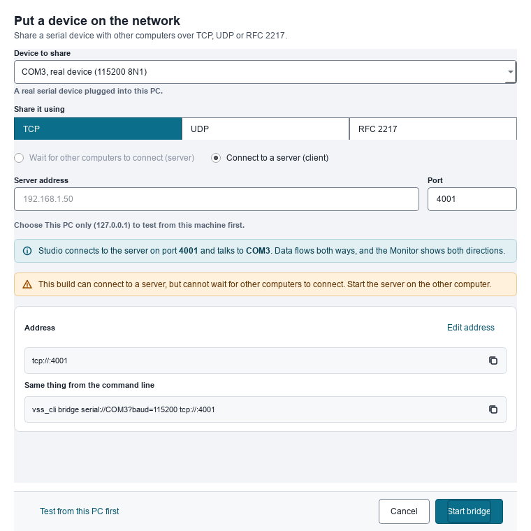

### Mock fixture (Advanced)

A scripted pretend device with a name, baud rate and target, for tests without
hardware.

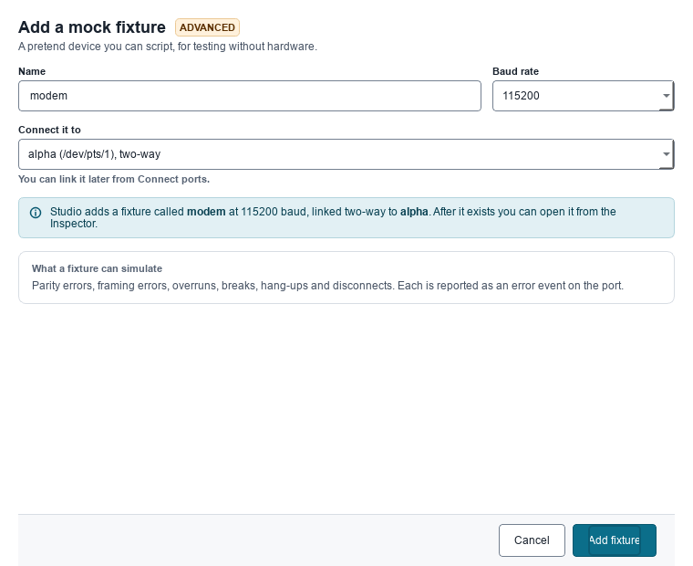

Select the fixture and choose **Open line matrix and faults** in the Inspector
to inject a fault: a parity error, a framing error, an overrun, a break, a
hang-up or a disconnect. Each one is reported as an error event on the port, and
the fixture then stops and shows *Failed*, as a real device would after the
fault. Add another fixture to inject again. Every fault you inject is listed in
**Injected so far**. Faults work only on fixtures; the buttons are off for any
other port.

The same dialog holds the **line matrix** for the link between the fixture
and the port it is linked to. The rows are the outputs DTR and RTS and the
columns are the inputs DSR, CTS, DCD and RI; tick a box to make that output
drive that input on the other port, or pick a preset. A change applies at once,
including to the inputs the other port already shows. The default is the
null-modem cable (DTR to DSR and DCD, RTS to CTS) and one wiring serves both
directions of the link. The wiring lasts while Studio runs and is not saved in a
setup file. A port whose driver cannot set RI shows it in Studio only.

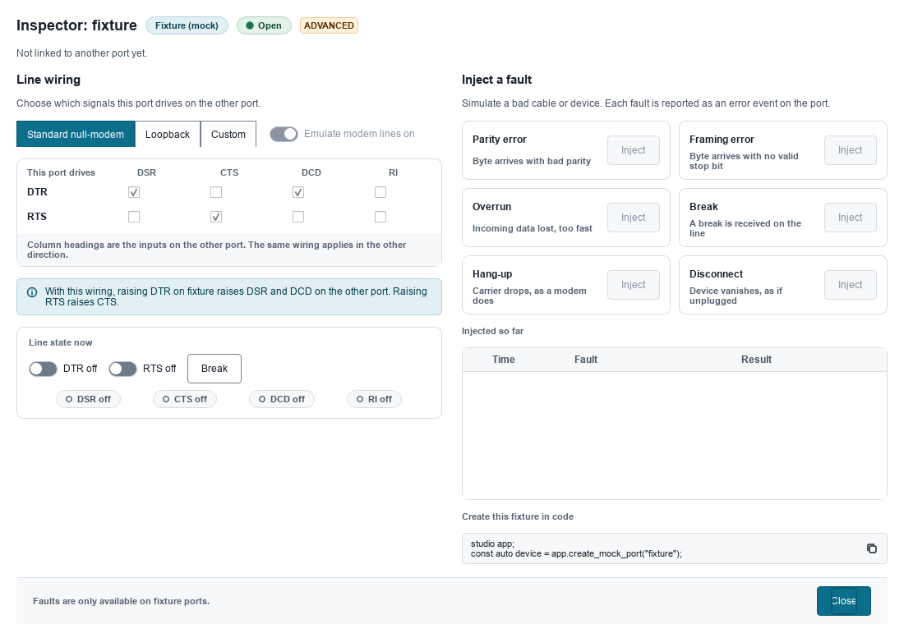

## Connecting ports

**Topology → Connect ports…** (`Ctrl+L`, enabled once two ports exist) creates a
link:

| Relationship | Use it when | What the target sees |
|---|---|---|
| **Two-way** | Two ports should behave like a null-modem cable. | Everything, both directions. |
| **One-way redirect** | Data must flow from A to B only. | Writes from A; B cannot reply. |
| **Monitor** | You want to watch without disturbing. | A one-way copy that never drives modem lines. |
| **Split one port to many** | Several programs must see the same device. | Each target receives a copy of the source. |
| **Join many ports into one** | Several publishers feed one program. | The target receives every publisher's data. |

The dialog lists only ports that exist, refuses a port linked to itself, needs
at least two targets for a split and two publishers for a join, and prints a
sentence describing the result before you commit. A link that would make a loop
is refused, with a message naming the pair, and nothing changes.

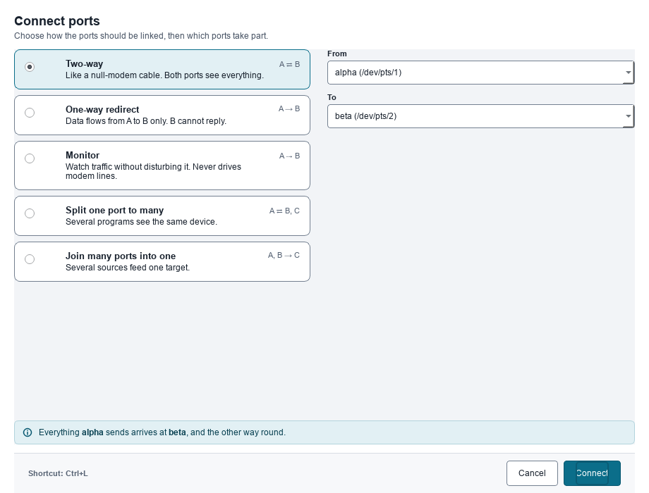

Remove a link by selecting its line and pressing `Delete`, or **Topology →
Remove link**. Removing a port removes its links too, after a confirmation.

## Sharing one device with several programs

**Topology → Share a device** opens a wizard.

1. **Choose the device** to share, and a name.
2. **How many programs?** (1 to 32). The table lists the port each program will
   open and whether other programs can open it. In step 1 you can change the
   device's settings or use **A network device instead**. On Windows each outside program
   needs its own com0com pair. When there are not enough free pairs the wizard
   warns, for example "Only 2 of the 3 programs can open their port", and
   offers **Create another pair** (administrator permission) or **Keep the
   third as Studio only**. On Linux and macOS every port is a pseudo terminal.
3. **Share device** builds the ports and the split link, and ends on a summary
   of what each program should open. If any step fails, the wizard removes what
   it created. **Add another program** on the summary builds the share again
   with one more port, because the engine cannot add a listener to a share that
   exists.

Everything the device receives is copied to all of the ports. Whatever a
program writes goes back to the device. In Advanced, **Share a device** is also
on the toolbar.

The three steps of the wizard, on Windows. The second picture shows the case
where no driver pair is free, so the ports work only inside Studio.

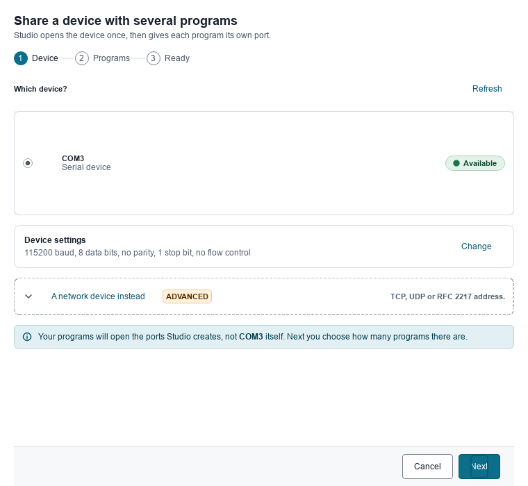

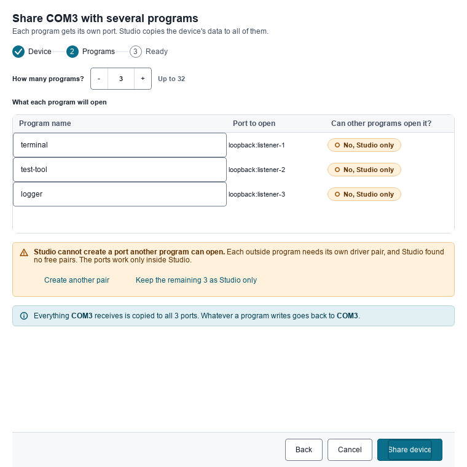

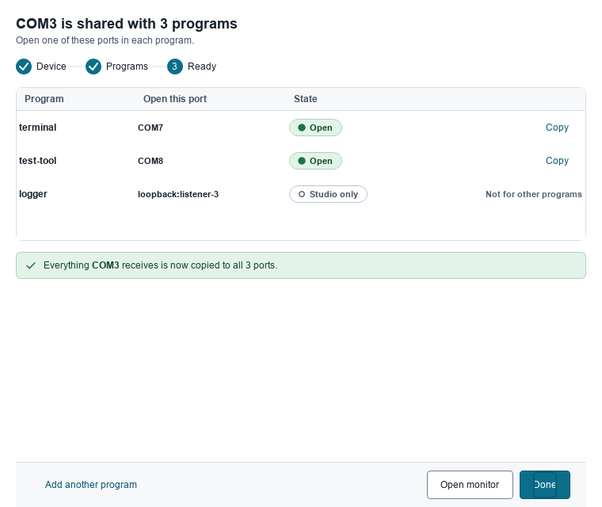

## Watching traffic

**Topology → Watch traffic** makes a read-only copy of a port. Choose the port
and a name for the watcher. The watcher is a Studio-only port, shown in the
ports list so you can remove it when you have finished, and it never drives
modem lines. With **Open the monitor when it is ready** ticked, Studio selects
the watched port and brings the monitor forward. The monitor is not filtered to
that port; in Advanced you can set the port filter yourself.

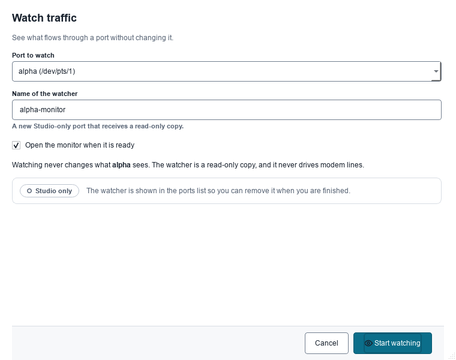

## The monitor and the Send panel

The **Monitor** shows a row per transfer: **Time**, **Port**, **Direction**
(`RX`, `TX`, or `DROP`), **Bytes** and **Preview**. A `DROP` row is one line each
time a link's dropped count grows, for bytes that a port without the owner's
right to write tried to send. It shows the count and not the bytes, because the
hub does not publish them.

- **Pause** (or `Space` in the table) stops appending. Traffic still flows and
  is counted. **Clear** empties the view. **Hex** shows payloads as
  hexadecimal. **Follow** keeps the newest row visible.
- In Advanced you can also filter by port and by RX, TX or Dropped, search the
  payload (`Ctrl+F`), switch between ASCII and Hex, and **Export** the visible
  rows as text. **Export capture** saves the same rows as a capture file
  (see [Capture files](#capture-files)).
- The monitor keeps the latest 10,000 rows, and no more than 32 MiB of their
  bytes, oldest first. The **Preview** column stops at 256 bytes, but the
  rows keep every byte for **Export capture**. For a record that does not stop
  at what the window holds, use `vss_cli capture`.

### Capture files

A capture is the traffic written with its exact time, in a form another
program can read. The monitor's **Export** is for reading: its **Time** is when
the window received a batch, and it cuts each payload to the preview. **Export
capture** and `vss_cli capture` write every byte, and the time is the one the
engine read when the bytes moved. That is a single clock for every port,
including a port whose other end is on another computer: the remote machine's
own clock is never used.

Each record has an offset in milliseconds from the start of the capture, the
port, a direction and the bytes of one transfer. The direction is from the
port's point of view:

- **R** is bytes the port *received*, from whatever is attached to it: the
  program that opened it, a device, a remote client.
- **W** is bytes *written to* the port, which the hub sent on to that attachment.

On a link, one transmission is `R` on the sender's port and `W` on the port of
every receiver, and a watcher port made with **Watch traffic** shows it once, as
`W`. To keep one row for each message, capture only the port you want
(`--port` on the command line); in the window, set the port filter first, as
the export writes the rows that pass the filters.

| Format | What it holds |
|---|---|
| `.cap` | Text: `[         142] R 0x10\|0x02\|0x50`, one line per transfer. The offset is right aligned in ten columns, the bytes are lower-case hexadecimal, and lines starting with `#` are comments. The file has no port names, so capture one port per file. |
| `.csv` | A header row, then `time_utc,offset_ms,port,direction,bytes,hex` for each transfer: the absolute time, the offset, the port name, `R` or `W`, the length, and the bytes as `10 02 50`. |
| `.jsonl` | One JSON object per line. The first has `started_utc`, the wall clock at offset zero. Each later one has `offset_ms`, `time_utc`, `port`, `direction`, `bytes` and `hex`. |

Offsets are whole milliseconds, so two transfers in the same millisecond have
the same offset; the order of the lines is the order the engine delivered them.

**Send** writes bytes into an open port: choose **Send to port**, type text, or
tick **Hex** for hexadecimal (it is checked as you type), leave **Add CRLF**
ticked to end the line, and press **Send**. In Advanced, **Repeat** sends at an
interval and **Saved sends** keeps your favourites. Engine errors appear as a
message and in the log.

## Control lines

Select a real serial port to see its control lines in the **Inspector**. Simple
shows DTR, RTS, CTS, DSR, DCD and RI as read-only chips ("DTR on" or "DTR
off"). Advanced turns **DTR** and **RTS** into switches and adds a **Break**
button. Virtual ports accept the operations and report their own state; they
have no physical wires.

## Link wiring and ownership (Advanced)

- **Topology → Link wiring** shows how the control lines of a pair are wired.
  It shows the standard null-modem preset, read only.
- **Topology → Owner** shows the owner bar for a link that uses an owner
  policy. The owner can be released or given to another port.
- **Tools → Benchmark** sends data from one port and counts what arrives on
  another, so you can measure a cable or a driver pair. Choose the two ports,
  the amount (1, 10 or 100 MB) and the chunk size, then **Run**. The bar shows
  progress, and **Cancel** stops the run. The result is *Passed* when every byte
  arrived and *Failed* when some did not, with the number lost; **Copy result**
  puts the figures on the clipboard. The two ports must not be linked in
  Studio, because the data has to travel through the cable or the driver pair.
  It is the same measurement as `vss_cli bench`, and the dialog shows the
  matching command.

Some of these depend on what the engine can do; see
[what this build cannot do](#what-this-build-cannot-do).

## Saving, opening and templates

A setup is a JSON document that lists the ports and links.

- **File → Save** (`Ctrl+S`) and **Save as** (`Ctrl+Shift+S`) write the current
  setup. **File → Open** (`Ctrl+O`) applies a saved one; **Open recent** opens
  the latest.
- The title bar shows `*` while there are unsaved changes. Closing, **New** and
  **Open** ask first, and you can turn that off in Settings.
- **File → Setups and templates** offers ready-made setups: a test bench, a
  device on the network, three programs sharing one device, and two programs
  with an owner. A template that needs a real device says "Needs a real device"
  and cannot be used yet.

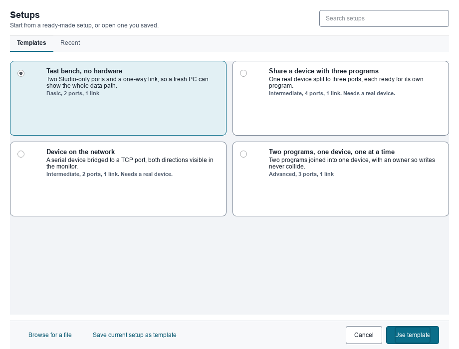
- **File → Export as command** (Advanced) shows the `vss_cli` command that
  builds the current setup.

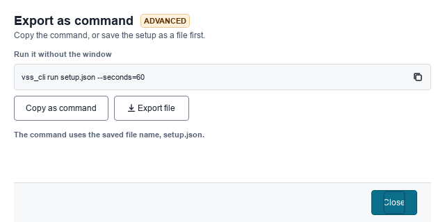

The same file can be replayed without the window:

```bash
vss_cli run topology.json --seconds=60
```

## Network addresses

Under the choices in the dialogs, every endpoint is an address. The engine
accepts these forms, and you can type them in Advanced and in `vss_cli`:

| Address | Meaning |
|---|---|
| `serial://COM3?baud=115200` | A real serial device with framing options. |
| `tcp://host:port` | A TCP client: Studio connects to a server. |
| `udp://host:port` | UDP datagrams sent to and received from one address. |
| `tcp-listen://host:port` | A TCP server: Studio waits for other computers. Any number can connect; what you send goes to all of them. |
| `udp-listen://host:port` | UDP datagrams from any sender; replies go to the senders heard from lately. |
| `rfc2217://host:port` | RFC 2217 serial-over-network: Studio connects to an access server. |
| `rfc2217-listen://host:port` | An RFC 2217 access server: Studio waits for serial-over-network clients such as pySerial's `rfc2217://`. |
| `loopback:name` | An in-process loopback endpoint. |

An RFC 2217 server speaks Telnet with the COM-PORT option, so a client opens
it as a serial port. Data passes through as it would for TCP. The client's
DTR and RTS are the endpoint's output lines, so a linked port sees them as
DSR, CTS and DCD, and the CTS, DSR, DCD and RI that reach the endpoint are
sent to the client as modem state.

To let other computers connect, allow the port through the host firewall and
listen on an interface they can reach (`0.0.0.0` for all interfaces). Try
`127.0.0.1` first. Studio does not use the network unless you add an endpoint
like these.

## When the operating system asks, or says no

Windows, Linux and macOS each protect the computer in ways that can stop a
serial program or a network listener. Studio looks at these for you in **Tools →
Setup check**, says what it found, and tells you the smallest thing to do. It
follows three rules:

- **It tells you before anything happens.** Studio never raises its own rights,
  never changes a firewall rule and never changes a system setting without a
  button you press, after it has shown you exactly what it will do.
- **It says "Not checked yet" when it cannot tell.** It does not guess.
- **It never turns a protection off.** The fix is always a narrow permission, or
  a command for you to run yourself.

### Windows

**Administrator rights.** Studio and its command line run as you, and none of
them asks for administrator rights when it starts. A step that needs them (a new
com0com pair, a firewall rule) asks Windows for permission when you press its
button. Windows shows its own **User Account Control** window; that window is
the permission. The Setup check row *Administrator rights* says whether Windows
will ask you only to confirm (your account is an administrator) or to type an
administrator's password (it is not). *Restart as administrator* restarts the
whole program with those rights; if you decline the prompt, Studio keeps running
as before and says so.

**Windows Firewall.** Nothing is asked while Studio listens on this PC only
(`127.0.0.1`). When a network endpoint waits for other computers on `0.0.0.0` or a
network address, Windows Firewall blocks them until a rule allows it. The
*Network endpoint* dialog then shows **Check Windows Firewall for this port**, and
the Setup check shows a *Windows Firewall* row. They open a dialog that says:

- what Windows Firewall will do to this port, from reading its rules (Studio only
  reads them);
- the one rule Studio can add: this program, one protocol, one port, computers on
  your local network only, on the network you are on now (private, domain or
  public) and no other;
- the same rule as a `netsh` command, if you would rather run it yourself.

**Allow in Windows Firewall** starts a small helper (`vss_cli`, the command line
beside the program) through the Windows permission prompt. The helper does that
one thing and refuses any program that is not Studio. A rule that blocks the
program, or the *Block all incoming connections* setting, is never changed by
Studio; the dialog says where to change it. Remove the rule in Windows Defender
Firewall (its name starts with *Virtual Serial Studio*), or with the command
`netsh advfirewall firewall delete rule name="…"` that the dialog shows.

The same check is available from a terminal and changes nothing:

```
vss_cli permissions check --listen=tcp-listen://0.0.0.0:4001
```

## Finding things: the command palette

`Ctrl+K`, or the **Search actions** box in the toolbar, opens a list of every
action. Type a few letters, use the arrow keys and press `Enter`. Actions that
need Advanced mode are listed with a prompt that offers to turn it on.

## Settings

**Tools → Settings** (`Ctrl+,`) has three pages. Changes apply immediately.

- **General**: *Advanced mode*, *Default baud rate* (offered first when you
  attach a device) and *Ask before discarding an unsaved setup*.
- **Appearance**: *Theme* (follow the system, light or dark) and *Density*
  (comfortable or compact). Text size, display scale, high contrast and reduced
  motion follow your operating system.
- **Performance**: *Refresh interval*, 50 to 5000 ms. Shorter feels live;
  longer is lighter on a busy machine.

**Reset to defaults** restores them. The values are stored with `QSettings` (the
registry on Windows, a configuration file on Linux and macOS).

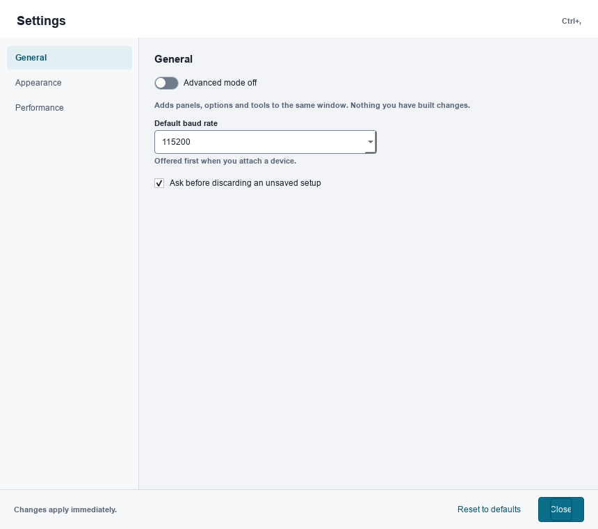

## Help and diagnostics

- **Tools → Setup check** says what this PC needs so other programs can use
  your ports. On Windows it looks for the com0com driver, whether administrator
  rights will be needed, whether Windows Firewall lets other computers reach a
  port you listen on, and the real serial devices. On Linux and macOS it
  looks at pseudo terminals and your serial port group. The status bar chip
  shows "Setup ready" or "Setup needs attention" and opens the same dialog.

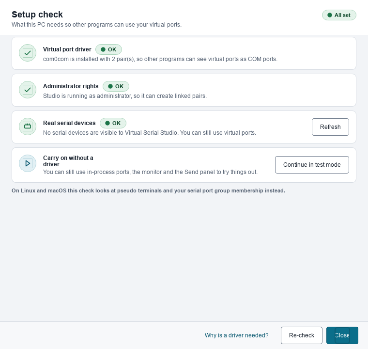

- **Help → Why is nothing arriving?** walks the steps between the device and
  your program (the port is open, it is linked, the device is sending) and
  suggests what to try. On Linux Studio can see whether a program has opened
  a pseudo terminal, so those checks say so. Everywhere else it cannot, and the
  last two checks read "Not checked yet".

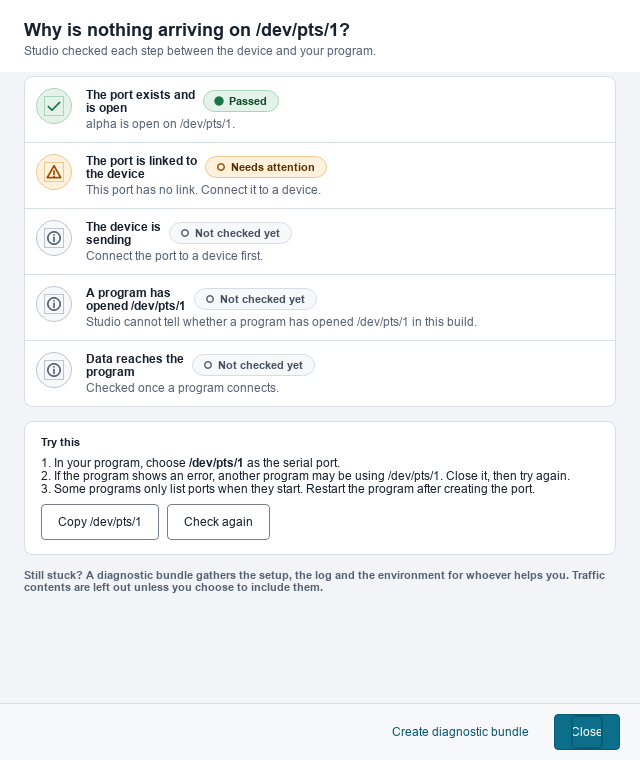

- **File → Diagnostic bundle** saves a ZIP with the setup, the event log, the
  environment and the port counters. Traffic contents are left out unless you
  tick them. Nothing is sent anywhere; you choose where to save the file.

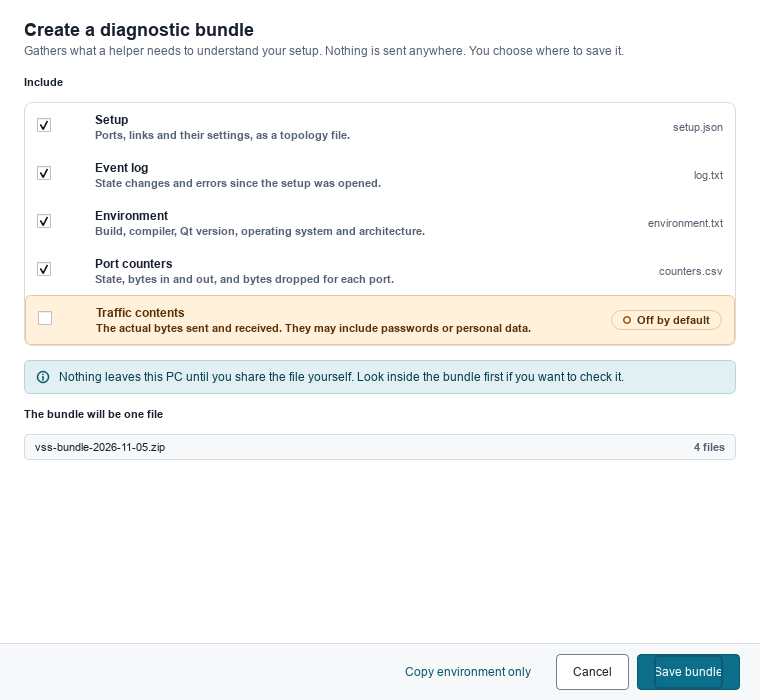

- **Help → Keyboard shortcuts** lists every shortcut; **Help → Copy
  environment** copies the build details for a bug report.
- **Help → About** has four tabs: About (version and the GPLv3 notice),
  Environment (commit, branch, build, compiler, Qt, operating system and the
  language chosen), Licences (Qt, Boost, Boost.VirtualSerial, Tracy and the
  optional com0com driver) and Fonts (none are bundled).

The application is available in nine languages and follows the system
language. See [i18n.md](i18n.md).

## Keyboard shortcuts

`Ctrl` is `Cmd` on macOS.

| Shortcut | Action |
|---|---|
| `Ctrl+N` / `Ctrl+O` | New / Open |
| `Ctrl+S` / `Ctrl+Shift+S` | Save / Save as |
| `Ctrl+Q` | Quit |
| `Ctrl+Shift+N` | Add port |
| `Ctrl+Shift+C` | Copy port name |
| `F2` | Rename the selected port |
| `Delete` | Remove the selected port or link |
| `Ctrl+Z` / `Ctrl+Shift+Z` | Undo / Redo the last link or owner change |
| `Ctrl+L` | Connect ports |
| `Ctrl+K` | Search actions |
| `Ctrl+,` | Settings |
| `F5` | Refresh now |
| `Ctrl+Shift+A` | Advanced mode |
| `Ctrl+0` | Fit the topology (Advanced) |
| `F1` | Help contents |
| `Space`, `Ctrl+F` | In the monitor: pause, search |

## What this build cannot do

A control that the engine cannot back is shown disabled, with the tooltip "Not
available in this build". It never pretends. At the moment:

- **Undo of everything**: Undo and Redo cover connecting a link, removing a
  link, changing an owner and renaming a port. They do not cover adding or removing a port, a
  wizard or applying JSON, because a port that is made again is a different
  port. Any of those starts a new history.
- **Reconnect a failed port**: a port that stops shows *Failed* and keeps its
  links, but the engine has no call to reopen it.
- **Editing a link that exists**: modem-line emulation and the merge policy are
  fixed when the link is created.
- **"In use" for a device**: shown only if the engine can prove it, and it
  cannot, so a busy device fails when you attach it.
- **Real-device templates**: they need the attach dialog to open from a
  template.
- **"Waiting for a program" and "Program connected" on Windows and macOS**:
  Studio can see whether a program has opened a port only for a pseudo terminal
  on Linux. Everywhere else a port reads **Open** and no more.
- **Settings sent by an RFC 2217 client** (baud rate, data bits, parity, stop
  bits, flow control): the server accepts and reports them but does not apply
  them to a real device linked to it. DTR, RTS and break from the client are
  passed on as control lines.

The reasons and the plan for each are in
[gui-design/docs/08-engine-gaps.md](https://github.com/iainchesworthlabs/virtual-serial-studio/blob/develop/docs/gui-design/docs/08-engine-gaps.md).

## Troubleshooting

**No COM ports appear on Windows.** A virtual COM port needs a pair driver.
Open **Tools → Setup check**. Without com0com, *Best available* falls back to an
in-process loopback, whose path is `loopback:<name>` and which other
applications cannot open. Pseudo terminals do not exist on Windows.

**A pseudo terminal path is shown but another program cannot open it.** On
Linux the path is `/dev/pts/N`; it exists only while the studio is running.
Check the permissions of the user running the program.

**A real device cannot be opened.** Another program may hold it, or it was
unplugged. Close the other program and try again. On Linux, add your user to
`dialout` and log in again; the setup check shows the command.

**Network peers cannot connect.** Check the firewall (on Windows, the Setup check
row and the dialog behind it in the Network endpoint dialog read the rules and
show what is missing), that you listened on an
address the peer can reach, and that the port number matches. Test locally with
`127.0.0.1` first.

**The counters do not move.** Check the state in the Ports table; a port that
is *Failed* or *Closed* does not carry traffic. Use **Help → Why is nothing
arriving?**, and in Advanced the **Log** tab, which records state changes and
errors.

**A port failed while running.** The row shows *Failed* and the links to it are
kept. Fix the cause (for example, plug the cable back in) and attach the device
again.

## Command line equivalents

| Task | Command |
|---|---|
| Create one virtual port | `vss_cli virtual --kind=auto` |
| Create a port with a stable name (Linux, macOS) | `vss_cli vport --name=ttyVSS0` |
| Create and hold a topology | `vss_cli run topology.json` |
| Share a device | `vss_cli share serial://COM3 --listeners=3` |
| Join publishers | `vss_cli join tcp://a:1 tcp://b:2 --target=serial://COM4` |
| Bridge two transports | `vss_cli bridge serial://COM3 tcp-listen://0.0.0.0:4001` |
| Loopback demo | `vss_cli loopback` |
| List devices | `vss_cli devices` |
| Record traffic to a file | `vss_cli capture topology.json --out bus.cap --port master` |
| Record a port without a topology | `vss_cli capture --uri=serial://COM5 --out run.jsonl --seconds=60` |
| Measure throughput | `vss_cli bench --from=… --to=…` |
| Self-test the wiring | `vss_cli selftest` |
| Check what the system may block | `vss_cli permissions check` |

### Recording with `vss_cli capture`

```bash
vss_cli capture <topology.json | --uri=<uri> ...> --out=<file>
                [--format=cap|csv|jsonl] [--port=<name>[,<name>...]]
                [--seconds=N]
```

`capture` applies the topology (or opens each `--uri`, which may be repeated;
each one is named by its URI), starts recording and keeps the ports open until
you press `Ctrl-C`, it receives `SIGTERM`, or `--seconds` has passed. It does
not wait for a window to refresh, and it does not cut payloads, so every byte
that moves is in the file, with the time the engine saw it. The format is
`--format`, or comes from the extension of `--out` (`.cap`, `.csv`, `.jsonl`),
or is `cap`. Each line is flushed as it is written, so a file is complete up to
the last transfer even if the process is killed. A port whose *Capture
traffic* is off in the topology is not recorded. `--port` names the ports to
keep (see [Capture files](#capture-files) for why you usually want one), and
the command stops with a list of the real names if one is wrong. The file is
readable by its owner only, where the system has such a setting.

See [ux.md](ux.md) for the design reasoning, [scenarios.md](scenarios.md) for
worked examples and [the screen specifications](https://github.com/iainchesworthlabs/virtual-serial-studio/blob/develop/docs/gui-design/docs/00-product-brief.md) for the
screen specifications.
